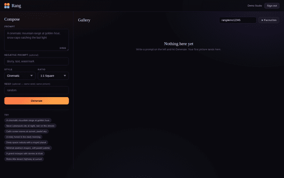
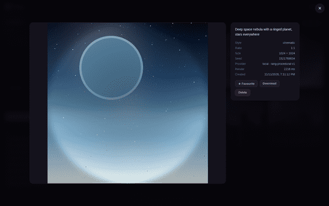

# Rang — AI Image Studio

**رنگ** — write a prompt, get a picture, keep a gallery.

Rang is a full-stack image generation studio. It parses your prompt into a
structured scene, renders it deterministically, and shows you exactly what it
understood — so the same prompt and seed always give you the same image.


---

## Why this one is different

Most image tools are a text box and a picture. You don't know why you got what
you got, and you can't get it again.

Rang does two things differently:

**It shows its reasoning.** Before you generate, the composer tells you which
palette, subject, style and mood it read out of your prompt, and which keywords
it matched. Nothing is hidden.

**It's reproducible.** Same prompt + same seed = byte-identical image. That's
what makes a gallery worth keeping instead of a slot machine.

And it runs with **no API key and no network**. The default provider composes
images procedurally with Pillow. Gemini is available if you want it, but you
don't need it to use the app.

---

## Features

- **Prompt → structured scene.** A parser maps your words onto palettes,
  subjects, styles and moods, and reports every match.
- **Deterministic rendering.** Seeded, so renders are reproducible.
- **9 subjects** — mountain, city, ocean, forest, space, portrait, architecture,
  road, abstract, animal.
- **6 styles** — cinematic, neon, watercolour, minimal, retro, dreamy.
- **6 aspect ratios** — 1:1, 16:9, 9:16, 3:2, 2:3, 4:5.
- **Pluggable providers** — local (Pillow) or Gemini, chosen per request.
- **Gallery** with search, favourites, pagination and a detail lightbox.
- **JWT auth** with bcrypt hashing and per-user isolation.
- **Rate limiting** and security headers out of the box.
- **51 tests**, ruff-clean, black-formatted.

---

## Screenshots

| Composer | Gallery |
|---|---|
|  |  |

| Detail view | Mobile |
|---|---|
|  |  |

---

## Quick start

```bash
git clone https://github.com/mohdabrarbaloch-arch/day-18-rang.git
cd day-18-rang

python3 -m venv .venv
source .venv/bin/activate
pip install -e ".[dev]"

# optional: seed a demo account with 8 real renders
python -m app.seed

uvicorn app.main:app --reload
```

Open <http://127.0.0.1:8000>.

Demo account (after seeding): **demo@rang.pk** / **rangdemo12345**

API docs: <http://127.0.0.1:8000/docs>

---

## Docker

```bash
docker compose up --build
```

That brings up the app on port 8000 with Postgres 16 behind it. To run against
Postgres locally without Docker, set `DATABASE_URL` and start the app — the
schema is created on boot.

---

## Configuration

Every variable is documented in `.env.example`. The ones that matter:

| Variable | Default | What it does |
|---|---|---|
| `SECRET_KEY` | dev placeholder | **Change this.** Signs JWTs. |
| `DATABASE_URL` | SQLite | Postgres URL switches the backend |
| `IMAGE_PROVIDER` | `local` | `local` or `gemini` |
| `GEMINI_API_KEY` | empty | Only needed for the Gemini provider |
| `CORS_ORIGINS` | `*` | Comma-separated allow-list |
| `RATE_LIMIT_GENERATE` | `20/minute` | Per-IP limit on generation |

---

## API

| Method | Path | Auth | Purpose |
|---|---|---|---|
| `POST` | `/api/auth/register` | — | Create an account, returns a token |
| `POST` | `/api/auth/login` | — | Sign in |
| `GET` | `/api/auth/me` | ✓ | Current user |
| `POST` | `/api/preview` | — | Parse a prompt without rendering |
| `GET` | `/api/providers` | — | Which providers are available |
| `POST` | `/api/generate` | ✓ | Render and save an image |
| `GET` | `/api/generations` | ✓ | List, search, paginate, filter favourites |
| `GET` | `/api/generations/{id}` | ✓ | One generation |
| `PATCH` | `/api/generations/{id}/favourite` | ✓ | Toggle favourite |
| `DELETE` | `/api/generations/{id}` | ✓ | Delete |
| `GET` | `/api/images/{id}` | — | Full image (PNG) |
| `GET` | `/api/images/{id}/thumb` | — | 480px thumbnail |
| `GET` | `/api/health` | — | Health check |

Full reference with request/response shapes: [`docs/api.md`](docs/api.md).

---

## Tests

```bash
pytest -q          # 51 tests
ruff check .       # lint
black --check .    # format
```

No network, no API keys, no fixtures to download.

---

## Deployment

The repo ships with `vercel.json` and `api/index.py` for Vercel's Python
runtime. Set `SECRET_KEY` and (optionally) `DATABASE_URL` in the project's
environment variables, then deploy.

**Note on storage:** images are stored in the database, so the app works on
Vercel's ephemeral filesystem with no extra setup. For a real deployment with
volume, move blobs to object storage — see the scaling notes in
[`ARCHITECTURE.md`](ARCHITECTURE.md).

---

## License

MIT — see [LICENSE](LICENSE).

Built by [ABraz Baloch](https://github.com/mohdabrarbaloch-arch) as Day 18 of a
30-day build challenge.
